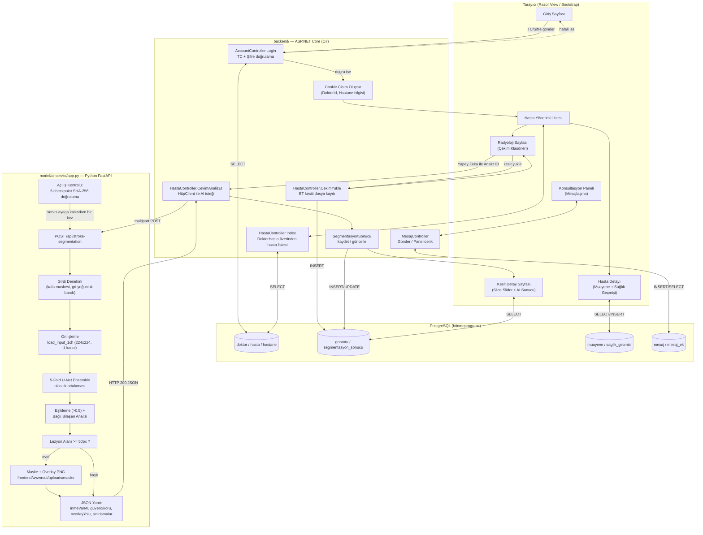
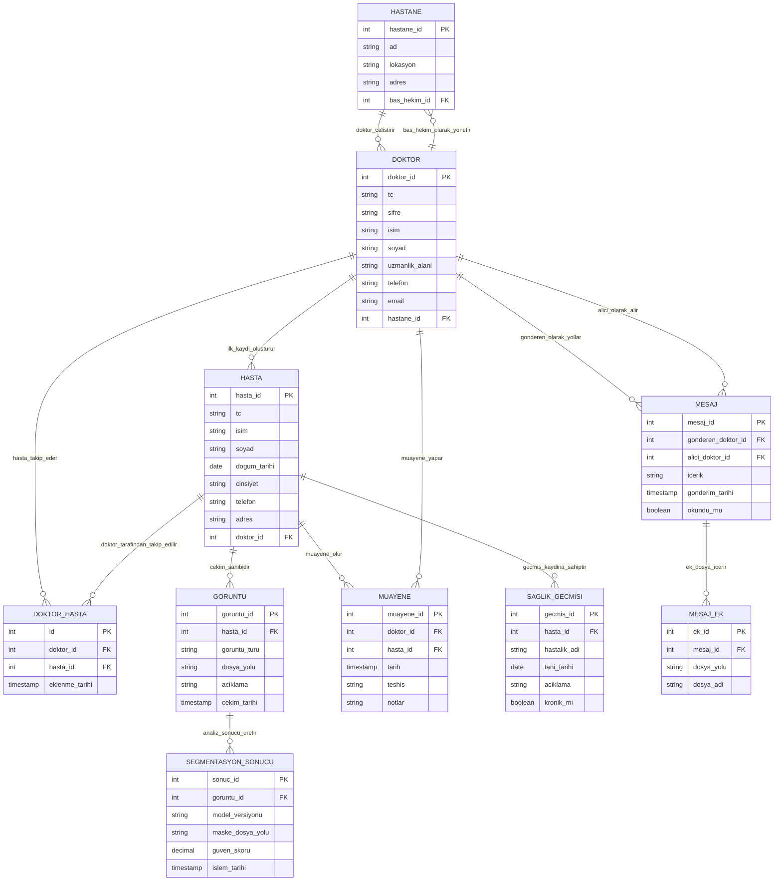
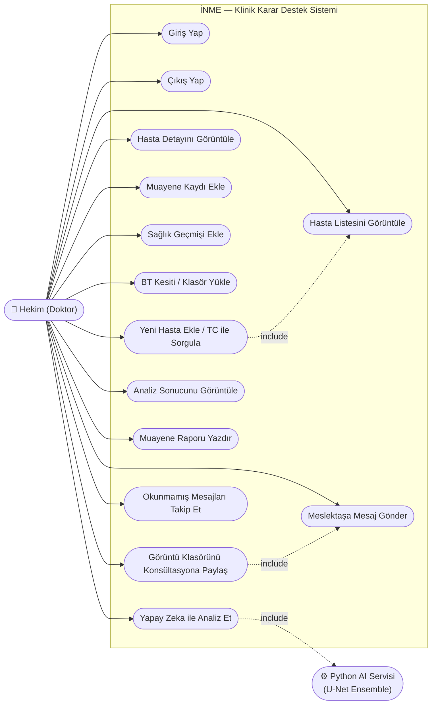

# BTİNME — BT Kesitlerinde İnme (Kanama) Tespiti için Klinik Karar Destek Sistemi

Hekimlerin hasta/muayene kayıtlarını tuttuğu, beyin BT kesitlerini yükleyip
bir U-Net segmentasyon modeliyle kanama şüpheli bölgeleri otomatik
işaretleyebildiği ve aynı hastanedeki meslektaşlarıyla görüntü üzerinden
konsültasyon yapabildiği bir web uygulaması.

> **Önemli — tıbbi sorumluluk reddi:** Bu sistem bir tanı aracı değildir.
> Model yalnız kanama türü lezyonlar üzerinde değerlendirilmiştir, güven
> skoru klinik olasılık olarak yorumlanamaz ve hiçbir çıktı hekim
> değerlendirmesinin yerine geçmez. Ayrıntılı sınırlamalar için
> `model/ai-servisi/app.py` içindeki `SINIRLAMALAR` sözlüğüne bakınız.

## İçindekiler

- [Mimari](#mimari)
- [Klasör yapısı](#klasör-yapısı)
- [Kurulum](#kurulum)
- [Çalıştırma](#çalıştırma)
- [Model hakkında](#model-hakkında)
- [Bilinen sınırlamalar](#bilinen-sınırlamalar)

## Mimari

Sistem üç parçadan oluşuyor: ASP.NET Core MVC ile yazılmış bir web uygulaması
(backend + sunucu tarafı görünümler), bu uygulamanın sunduğu statik dosyalar
(frontend) ve ayrı bir süreç olarak çalışan Python/FastAPI tabanlı yapay
zeka servisi. Backend, bir BT kesiti için analiz istendiğinde bu servise
HTTP isteğiyle bağlanır.

### Genel akış



### Veritabanı ER diyagramı



### Use case diyagramı



Yukarıdaki üç diyagramın düzenlenebilir (diagrams.net / draw.io) kaynak
dosyaları `docs/diagrams/` klasöründe bulunur:

- [docs/diagrams/hasta_akis_diyagrami.drawio](docs/diagrams/hasta_akis_diyagrami.drawio)
- [docs/diagrams/er_diyagrami.drawio](docs/diagrams/er_diyagrami.drawio)
- [docs/diagrams/use_case_diyagrami.drawio](docs/diagrams/use_case_diyagrami.drawio)

Düzenlemek için [app.diagrams.net](https://app.diagrams.net) üzerinden
*Dosya > Diyagram Aç* ile açabilirsiniz.

## Klasör yapısı

```
CTStrokeDetectionSystem/
├── frontend/
│   └── wwwroot/            # css, js, images, lib, uploads (statik dosyalar)
├── backend/                # ASP.NET Core MVC (Controllers, Models, Views, Migrations)
├── model/
│   ├── ai-servisi/         # FastAPI cikarim servisi (app.py) + duman testi
│   ├── cekirdek/           # U-Net mimarisi, kayip fonksiyonlari, on-isleme (tek kaynak)
│   ├── egitim/             # Egitim betigi (train_unet.py) + dataset_manifest.json
│   └── agirliklar/         # Egitilmis checkpoint'ler (.pt), unet_results.json, log
└── docs/
    ├── diagrams/            # .drawio diyagram kaynaklari (akis, ER, use case)
    └── entegrasyon_notlari.md
```

## Kurulum

### Gereksinimler

- [.NET 8 SDK](https://dotnet.microsoft.com/download)
- [Python 3.10+](https://www.python.org/downloads/)
- [PostgreSQL](https://www.postgresql.org/download/) (yerelde çalışan bir sunucu)

### 1. Veritabanı

PostgreSQL üzerinde `btinmeprogrami` adında bir veritabanı oluşturun ve
`backend/appsettings.json` içindeki `ConnectionStrings:DefaultConnection`
değerini kendi kullanıcı adı/şifrenize göre güncelleyin (depodaki değer
yalnız yerel geliştirme için bırakılmış bir örnektir, gerçek bir ortamda
kullanılmamalıdır):

```bash
dotnet ef database update --project backend
```

### 2. Backend (ASP.NET Core)

```bash
cd backend
dotnet restore
dotnet run
```

Uygulama varsayılan olarak `http://localhost:5072` adresinde açılır ve
doğrudan giriş sayfasına yönlendirir.

### 3. Yapay zeka servisi (Python/FastAPI)

```bash
cd model/ai-servisi
pip install -r requirements.txt
uvicorn app:app --host 127.0.0.1 --port 8000
```

Backend, `http://localhost:8000` adresindeki bu servise istek atacak şekilde
yapılandırılmıştır (`backend/Program.cs`). Servis açılırken 5 checkpoint
dosyasının SHA-256 bütünlüğünü otomatik doğrular; uyuşmazlık varsa servis
başlamadan hata verir.

> Backend ve AI servisi **ayrı süreçlerdir**; ikisinin de aynı anda çalışır
> durumda olması gerekir. AI servisi kapalıyken BT analiz isteği gönderilirse
> ilgili kesit sessizce atlanır (bkz. `HastaController.CekimAnalizEt`).

## Çalıştırma

1. PostgreSQL ve AI servisini ayağa kaldırın.
2. Backend'i çalıştırın, tarayıcıda giriş sayfası açılır.
3. Sisteme kayıtlı bir doktor (TC + şifre) ile giriş yapın.
4. "Hasta Yönetimi"nden bir hasta seçin → Radyoloji sekmesinden BT kesiti
   yükleyin → "Yapay Zeka ile Analiz Et" ile segmentasyonu çalıştırın.
5. Sonucu Kesit Detay sayfasında (maske + güven skoru + sınırlamalar) görün.
6. Sağ üstteki "Konsültasyon & Mesajlar" panelinden aynı hastanedeki bir
   meslektaşınıza görüntü klasörünü paylaşabilirsiniz.

## Model hakkında

- **Mimari:** 4 seviyeli U-Net (encoder-decoder), BatchNorm, bilinear
  upsample — `model/cekirdek/unet_model.py`.
- **Kayıp fonksiyonu:** Focal Tversky Loss (alpha=0.7, beta=0.3, gamma=0.75)
  — küçük/dengesiz lezyon alanlarını standart BCE+Dice'tan daha güçlü
  cezalandırır.
- **Topluluk (ensemble):** 5-fold çapraz doğrulamadan çıkan 5 checkpoint'in
  olasılık tahminlerinin ortalaması alınır (tek bir fold değil).
- **Girdi:** 224x224 tek kanal (gri) BT kesiti; kafa dışı bölge Otsu eşiği +
  en büyük bağlı bileşen yöntemiyle maskelenip sıfırlanır.
- **Eğitim verisi:** TEKNOFEST beyin BT veri seti. Boyut ve gizlilik
  nedeniyle ham görüntüler bu depoda yer almaz; `model/egitim/` içinde
  yalnız eğitim kodu ve fold/etiket atamalarını içeren
  `dataset_manifest.json` bulunur.

## Bilinen sınırlamalar

- Yalnız **kanama** türü lezyonlar için doğrulanmıştır; iskemik inme için
  model performansı ölçülmemiştir.
- İşaretlenen alan gerçek lezyondan sistematik olarak küçüktür (ölçülen
  oran ~%72-76).
- Birden fazla odak varsa bir kısmı yakalanamayabilir (ikincil odak
  yakalama oranı ~%63).
- Orta hat ve damar yapılarında yanlış pozitif işaretleme gözlenmiştir.
- Güven skoru **kalibre edilmemiştir**; klinik olasılık olarak
  yorumlanamaz.
- Bu liste `model/ai-servisi/app.py` içindeki `SINIRLAMALAR` sözlüğüyle
  birebir aynıdır ve her analiz sonucunda hekime aynen gösterilir.
